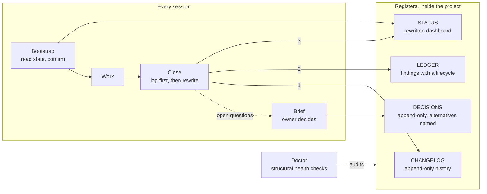

# project-docs-protocol

[](https://github.com/anthonylim9913/project-docs-protocol/actions/workflows/tests.yml)

**A continuity system for AI-assisted projects.** Any AI model, in any app, on any machine, picks up a project exactly where the last session left off — what is in progress, what was decided and why, what is blocked, what comes next.

Every AI session starts cold. Built-in memory belongs to one tool and one account, so it doesn't follow the project to another model, another app, another machine or another person. The result is a project re-explained at the start of every session, or worse, guessed. This system keeps the project's state inside the project, and is built to keep it accurate through long-running work: model switches, interrupted runs and handoffs.

## How it works



Four mechanisms work together.

**Registers, each with one job and one rule.**

| Register | Job | Rule |
|---|---|---|
| `STATUS.md` | The live dashboard: phase, in flight, blocked, next, open questions | Rewritten at every close, never appended to; kept under ~60 lines |
| `CHANGELOG.md` | What happened and why | Append-only; written first at every close |
| `DECISIONS.md` | Choices made, with the alternatives rejected | Append-only; a correction is a new entry, never an edit |
| `LEDGER.md` *(optional)* | Findings and checks too many for STATUS | One row per item, six lifecycle states, closed rows archived with evidence |
| `README.md` | How any agent uses the registers | The entry point for any model or app |

**Rituals that run the session.** *Bootstrap* reads state before any work is proposed. *Close* runs after each meaningful piece of work in a fixed order. *Brief* turns open questions into decisions the owner picks explicitly, recorded with the alternatives they rejected. *Install* sets a project up in one exchange. *Doctor* checks the whole register.

**Integrity by design.** The write order is the safety mechanism: the history is written before the dashboard, so an interrupted session can lose a STATUS update but never the record of what happened. History registers are append-only by rule; Doctor does not verify byte history, so a committed rewrite of a past entry is not caught by it. STATUS has a size ceiling, because a growing dashboard is history leaking into it. Decisions name the alternatives they rejected, so a later session builds on them instead of re-arguing them.

**Automated checks.** Doctor is a read-only health check with up to 46 named check types in a full register report, depending on what a project uses: wiring, register shape, write discipline, decision IDs, owed fragments and local branches, and the ledger's schema, lifecycle and evidence rules. An absent or unusable ledger substitutes a single aggregate `ledger` result for its detailed checks. Exit codes separate advisory drift from a broken property. With `--json` it prints the same report as one JSON object, for dashboards ([schema below](#doctor-output-for-dashboards)). It needs only Python's standard library.

`git-unlisted-branches` checks local heads (including other worktrees) in two Git calls, regardless of branch count. It WARNs on branches absent from visible STATUS that have non-register work outside HEAD, naming up to five with exact commit counts; named branches are INFO. Fully merged ancestry is excluded; squash and cherry-pick equivalence is not detected. Remote-tracking branches are excluded. The `main` and `master` branches and any remote's default branch are never counted, and a merge commit counts only as ancestry. A branch is listed when STATUS shows its whole name set off by spaces or backticks; write names in backticks to be safe. A shallow clone is SKIPped, because its cut-off history cannot be counted. History size still affects output and traversal. `--no-git` and unavailable history SKIP. `owed-fragments` names any of the three `*-ENTRIES-OWED.md` fragments beside the registers with WARN, or INFO when none; it also runs without Git. Both checks are advisory and never FAIL.

## Extensions, adopted when a project needs them

- **Findings ledger and reviewed migration.** When a project's open findings outgrow STATUS, they move into a ledger with stable IDs, a six-state lifecycle and an evidence requirement for closing. A reviewed migration moves them across with a recovery journal, so an interrupted migration can be replayed without losing or duplicating a row.
- **Research companion.** Sources, notes, open questions and syntheses with stable IDs and recorded provenance. Its checker fails closed on broken links, missing provenance and ambiguous IDs, so the trail from a claim back to its source passage stays intact.
- **Architect companion.** For larger changes: each stage gets a frozen scope and acceptance criteria, an independent reviewer checks the exact version against them, and the handoff carries the evidence and the reviewer's verdicts.
- **Skill registry.** Records which skills a project uses, who authorised each one, and a fingerprint of the reviewed version. A skill that has changed since review is treated as unavailable until it is reviewed again; nothing in the registry grants permission by itself.

## Works with any model, app or machine

Plain text was a deliberate choice: it is the one format every model can read and write, every app can open, and every repository carries to a new machine.

- **Apps that load `AGENTS.md` or `CLAUDE.md` at startup** run the system on their own. A short instruction block tells the agent to bootstrap before doing anything and to close after each piece of work.
- **Any app that can read files** starts with one sentence: *"Read `docs/README.md` and follow its session bootstrap."*
- **A plain chat window** still works: paste STATUS and the latest CHANGELOG entries in at the start, and paste the new entry and the rewritten STATUS back out at the end.

## Verified, not asserted

- **Audited across 25 projects** before going public. In the 7-row churn table, the three roots with close instructions (one carrying the block verbatim, two hand-written) rewrote STATUS (churn 0.67–0.83); the four others, two without instructions and two with project-authored "top line" instructions, accreted history (0.01–0.16). The largest CHANGELOG had 11,369 lines added and 1 deleted, with nothing enforcing it. The figures are in `docs/EVIDENCE.md`; the churn result is an association in a small, mixed sample, not proof of cause.
- **757 automated test methods**: 516 core, 123 research and 118 Architect; the 30 registry methods are included in core, not counted again. Python 3.9 or newer, standard library only. Filesystem-specific cases skip when the filesystem cannot establish their fixtures.
- **Independently reviewed.** Since v0.3.0 every release has been reviewed by a separate model session, and v0.4.1 was held until its re-review passed.
- **Tested with fresh sessions.** Three new agent sessions, each given an ordinary request with no hints, found the skill registry on their own. One used the skill the owner had authorised, one asked before adopting a skill that wasn't authorised, and one refused a skill that had changed since review and used its fallback.

Everything measured so far was run in Claude Code and Codex. Nothing in the system depends on either, but other apps and models haven't been measured yet.

## Install

**With nothing installed.** Copy `README.md`, `STATUS.md`, `CHANGELOG.md` and `DECISIONS.md` from `templates/` into your project's `docs/` folder, fill in STATUS, replace the template's placeholder CHANGELOG entry with the first dated entry (*Step 4* of `SKILL.md`), and add the instruction block from *Step 2* of `SKILL.md` to `AGENTS.md`, the default for every app; replace `<docs-path>` in the block with the real docs path. If an app loads a different instructions file (such as `CLAUDE.md` or `GEMINI.md`), point it at `AGENTS.md` or copy the block into that file as well; keep the block in `AGENTS.md` so Doctor can check it. Doctor counts only `CLAUDE.md` and `AGENTS.md` as wiring. That is a complete installation; if Python is available, run `python3 scripts/docs-doctor.py "<project-root>"` from a checkout of this repository to confirm it.

**As a skill**, for Claude Code and Codex, which then run Install, Close, Doctor and Brief for you:

```bash
git clone https://github.com/anthonylim9913/project-docs-protocol.git ~/.claude/skills/project-docs-protocol
mkdir -p ~/.codex/skills && ln -s ~/.claude/skills/project-docs-protocol ~/.codex/skills/project-docs-protocol   # Codex
```

Then, in any project, ask for "set up project docs". The skill recognises a project already using the system by its three registers plus either the instruction block or the install note in the docs README; the three filenames alone are not enough, because other conventions use them too.

**After upgrading.** Doctor may exit 1 with advisory `wiring-clauses` WARNs asking you to re-sync the block, or `git-unrecorded-commits`, `git-unlisted-branches` or `owed-fragments` WARNs, where it exited 0 before. These diagnostics never cause exit 2.

## Doctor output for dashboards

`python3 scripts/docs-doctor.py "<project-root>" --json` runs the same checks as the text report and prints them as exactly one JSON object on stdout, on one line (wrapped here for reading):

```json
{"tool": "docs-doctor", "schema": 1, "version": "1.10.0", "root": "/abs/project", "register_dir": "/abs/project/docs",
 "today": "2026-10-23",
 "checks": [{"id": "wiring-block", "level": "PASS", "message": "present in 1 of 1 instructions files: AGENTS.md"}],
 "summary": {"pass": 1, "warn": 0, "fail": 0, "info": 0, "skip": 0},
 "exit_code": 0, "error": null}
```

- **`schema`** is the version of this document's shape, currently `1`. It changes only when a key is added, removed or redefined, so a consumer can check it instead of parsing `version` (Doctor 1.6.0 is the first with `--json`).
- **`checks`** are the text report's lines, in the same order. `id` is the check name (the table in `SKILL.md`, *Mode 4*), `level` is `PASS`, `WARN`, `FAIL`, `INFO` or `SKIP`, and `message` is the text after the name on the text line. Which checks appear depends on what the project uses: without `LEDGER.md` there is one `ledger` SKIP instead of the ledger checks.
- **`summary`** counts `checks` by level. **`exit_code`** equals the process exit code and keeps the text mode's contract: 0 every check passed, 1 WARN only, 2 any FAIL, 3 the checker could not run.
- **`root`** and **`register_dir`** are absolute, resolved paths. Passing a `docs/` directory reports its parent as `root` only when that directory has no instructions file (`CLAUDE.md` or `AGENTS.md`), as the text report does.
- **A run that exits 3 still prints the object.** `register_dir` is `null` when no register was selected, `today` is `null` when `--today` was not a date, and `checks` holds whatever ran before a crash. The reason is on stderr, exactly as in text mode, and also in **`error`** (the same text without the `docs-doctor: ` prefix). `error` is `null` on exits 0–2.
- **Nothing else goes to stdout,** and the object is ASCII-only, so no locale can alter it. A command-line usage error exits 2 with a usage message on stderr and prints no object, so a consumer tells it apart from a FAIL by the missing object. `--help` and `--version` print their usual text.

The JSON says no more than the text report does: a structural PASS is still not semantic accuracy or a verified write order. Without `--json` the output is unchanged.

## Releasing

Before a release, run the release check from the repository root:

```sh
python3 -B scripts/release-check.py
```

It runs the three test suites, Doctor, the skill-registry check and three whitespace checks (unstaged, staged, and committed since the newest tag, or since `--base REF`). It then compares the test counts stated in this README, in STATUS and in the newest CHANGELOG entry with the counts it measured. It exits 0 only when everything passes.

- Add `--python PATH` once per interpreter to run the suites under each of them.
- A Doctor WARN fails the check unless you pass `--allow-doctor-warn`.
- A stated count it cannot tie to a suite is reported as "not checked". The accepted phrasings are listed in the script's docstring.
- `--skip-suites` exists for testing the script. It ends with `INCOMPLETE` and exit 3, never a pass.

The release check does not look for private text. That is the job of the optional privacy scan.

### Optional privacy scan before each push

`scripts/leak-scan.py` searches what you are about to publish for patterns you choose. No patterns ship with this repository.

1. Write your patterns in a file **outside the repository**: one Python regular expression per line. Blank lines and lines starting with `#` are ignored, and trailing whitespace is removed.
2. Tell the scanner where the file is, with `--patterns PATH`, the `LEAK_SCAN_PATTERNS` environment variable, or `git config leakscan.patterns PATH` (checked in that order).
3. Install the hook. If you already have a pre-push hook, add the scanner call to it instead of replacing it.

```sh
hook_path="$(git rev-parse --git-path hooks/pre-push)"
mkdir -p "$(dirname "$hook_path")"
cp scripts/hooks/pre-push.sample "$hook_path"
chmod +x "$hook_path"
```

To use it in another project, copy `scripts/leak-scan.py` into that project's `scripts/` folder as well. To scan by hand, run `python3 -B scripts/leak-scan.py --range BASE..HEAD`, or `--range HEAD` for the whole history.

What it scans, for every commit in the range: the changed files' contents, their paths, the commit message, and the author and committer names and emails. As a hook it also scans the names of the refs being pushed and the message and tagger of each annotated tag.

What it prints: the commit, the path and line, and the line number of the pattern in your file. It does not print the pattern or the matched text, and a path that itself matches is replaced by `[redacted]`.

Exit codes: 0 clean (or no patterns file configured, with a notice), 1 hits, 2 could not scan. A patterns file with no patterns, an invalid pattern, a missing object and empty hook input all count as "could not scan".

Limits:

- For a new branch, commits already on the destination remote's tracking refs are skipped. A stale tracking ref for a branch deleted on the server therefore hides its commits; a manual scan without a remote skips nothing.
- Files with a NUL byte in their first 8,000 bytes, which includes UTF-16 text, are skipped and counted.
- A slow regular expression has no timeout.
- The outside-the-repository rule catches symlinks, letter-case variants and hard links to tracked files, not hard links to untracked files.
- If Python itself fails while starting the scanner, its own error message can include the repository's path. The hook checks that `python3` and the scanner are present and readable first.

## Files

- **`SKILL.md`** — the full operating instructions: all five modes, the extensions, and which check to run when.
- **`templates/`** — starter files for every register and extension, plus the paste-ready [delegation brief](templates/DELEGATION-BRIEF.md) for tasks whose agents may never load project wiring.
- **`scripts/`** — Doctor, the reviewed ledger migration, the skill-registry validator, the release gate and the optional privacy scanner/hook.
- **`staging/`** — the research and Architect companions.
- **`tests/`** — the test suites. From the repository root, the core suite is `python3 -B -m unittest discover -v`; each companion has its own: `cd staging/research-protocol && python3 -B -m unittest discover -s tests -v`, and the same in `staging/architect-protocol`.
- **`docs/`** — this project's own registers. It runs the system it ships, so its STATUS, CHANGELOG, DECISIONS and LEDGER are a working example.

## Status

Built for my own multi-session projects, then audited, reviewed and tested before going public. Sharing it in case it is useful to others. Issues and pull requests are welcome, but treat it as a personal tool made public rather than a maintained product.

## License

[MIT](LICENSE)
